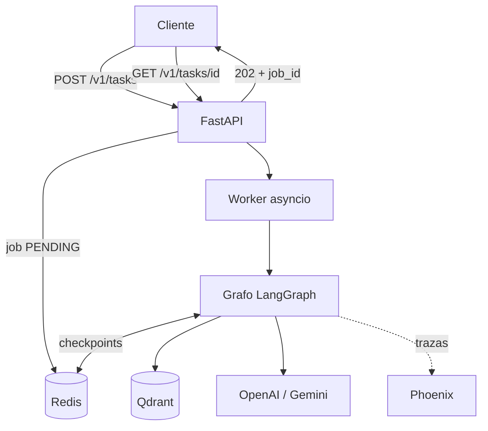
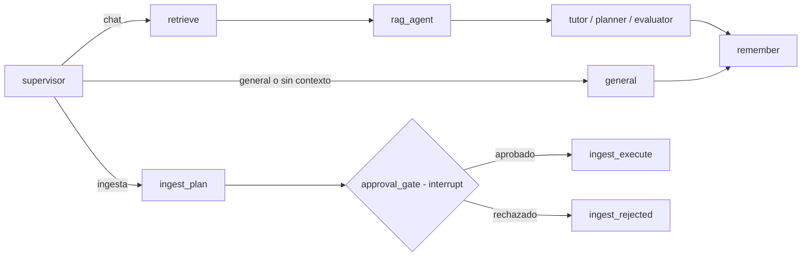

# Guitar Intelligence System

Profesor de guitarra con IA. Responde preguntas, arma lecciones y evalúa al alumno a partir de tus propios PDF y Word (incluidas las imágenes: tablaturas, acordes, diapasón, partituras). Integra:

- **RAG multimodal** híbrido (vectorial + BM25) sobre Qdrant.
- **Supervisor multiagente** con LangGraph (Supervisor, RAG, tutor, planificador, evaluador).
- **API FastAPI asíncrona**: las tareas se encolan, devuelven un `job_id` y se consultan por estado.
- **Redis** para el estado de los jobs y los checkpoints de LangGraph.
- **Human-in-the-loop**: la ingesta con análisis de imágenes se pausa hasta que una persona la aprueba.
- **Trazabilidad** con Arize Phoenix (OpenTelemetry/OpenInference).





## Requisitos

- Docker Desktop con Docker Compose.
- Una clave de OpenAI (embeddings y, por defecto, chat y visión). Gemini es opcional para chat/visión.
- PDF/DOCX para cargar (se suben por la API).

## Arranque

1. Copiá `.env.example` como `.env` y completá `OPENAI_API_KEY`.
   - **Los comentarios van en su propia línea.** Un comentario pegado al valor (`API_KEY=  # texto`) hace que Docker lo tome como parte del valor.
2. Levantá todo (API, **Redis**, Qdrant y Phoenix):

   ```bash
   docker compose up --build
   ```

3. Comprobá que está listo:

   ```bash
   docker compose ps
   curl http://localhost:8000/health/ready
   ```

   Debe responder `ready` con `qdrant: ok` y `redis: ok`.
4. Documentación interactiva de la API: `http://localhost:8000/docs`. Phoenix: `http://localhost:6006`.

Redis se inicializa solo: el servicio `redis` del Compose usa la imagen `redis/redis-stack-server` (incluye RedisJSON y RediSearch, que exige el checkpointer de LangGraph) y la API crea sus índices al arrancar.

## Prueba rápida de punta a punta

```bash
# 1) Subir un PDF: devuelve un job_id (202). El agente estima el costo de visión.
curl -X POST http://localhost:8000/v1/knowledge/ingest -F "file=@./mi_metodo.pdf"

# 2) Consultar el job: queda en WAITING_APPROVAL con el plan y el costo estimado.
curl http://localhost:8000/v1/tasks/<job_id>

# 3) Aprobar con un tope de llamadas de visión (o "approved": false para rechazar).
curl -X POST http://localhost:8000/v1/tasks/<job_id>/approve \
  -H "Content-Type: application/json" \
  -d '{"approved": true, "max_vision_calls": 5, "reviewer": "ana"}'

# 4) Preguntar (asíncrono) y consultar el resultado.
curl -X POST http://localhost:8000/v1/tasks -H "Content-Type: application/json" \
  -d '{"question":"¿Cómo practico el cambio entre Do y Sol?","session_id":"alumno-demo"}'
curl http://localhost:8000/v1/tasks/<job_id>
```

En PowerShell conviene usar `Invoke-RestMethod` con `ConvertTo-Json` en vez de `curl`, por el escapado de comillas.

## Endpoints

| Método y ruta | Qué hace |
|---|---|
| `GET /health` | Liveness: el proceso responde. |
| `GET /health/ready` | Readiness: comprueba Qdrant y Redis (503 si alguno falla). |
| `POST /v1/tasks` | **Encola** una consulta y devuelve `202` con un `job_id` (no bloquea). |
| `GET /v1/tasks/{job_id}` | Estado: `PENDING`, `RUNNING`, `WAITING_APPROVAL`, `DONE`, `REJECTED` o `FAILED` (con `result`, `plan` o `error`). |
| `GET /v1/tasks` | Últimos trabajos. |
| `POST /v1/tasks/{job_id}/approve` | **HITL**: aprueba o rechaza una ingesta pausada y la reanuda. |
| `POST /v1/knowledge/ingest` | Sube un PDF/DOCX y crea una tarea de ingesta (`202` + `job_id`). |
| `POST /v1/knowledge/ingest-folder` | Crea una tarea de ingesta por cada archivo de `DOCUMENTS_DIR`. |
| `GET /v1/knowledge/stats` | Cantidad de fragmentos indexados. |
| `POST /v1/chat` | Consulta síncrona (espera la respuesta). `session_id` mantiene la memoria; `intent` opcional fuerza la intención. |
| `POST /v1/chat/stream` | Como `/v1/chat`, pero emite por SSE cada paso del grafo y la respuesta final. |
| `GET /v1/media/{archivo}` | Imagen original (tablatura, acorde...) citada en una fuente (`image_url`). |

Si se define `API_KEY`, los endpoints `/v1` exigen el header `X-API-Key`.

## Cómo funciona el RAG

1. Extrae texto e imágenes de PDF y DOCX.
2. Interpreta cada imagen con el modelo multimodal. La salida se valida con Pydantic (`MusicInterpretation`: tipo de contenido, símbolos, confianza y si requiere revisión humana).
3. Divide el texto en chunks, conserva documento/página/tipo como metadatos y genera embeddings.
4. Indexa en Qdrant con IDs determinísticos (reingestar no duplica) y combina búsqueda vectorial con BM25 mediante Reciprocal Rank Fusion. El índice BM25 se reconstruye desde Qdrant al arrancar.
5. Las respuestas citan documento, página y, cuando hay una imagen, un `image_url`. Si no se recupera nada, el sistema responde como general y **lo avisa**, en lugar de simular una respuesta basada en los documentos.

La interpretación de diagramas musicales es probabilística: revisá las descripciones generadas antes de tratarlas como verificadas.

## Agentes y memoria

- **Supervisor**: clasifica la tarea con salida JSON validada con Pydantic (el motivo queda en el log) y delega. Considera el historial reciente.
- **RAG**: recupera conocimiento de los documentos. **Tutor**, **planificador** y **evaluador** generan la respuesta didáctica, la rutina o el examen.
- **Checkpointer**: el estado del grafo y el historial de cada `session_id` se guardan en Redis (`AsyncRedisSaver`), así que las repreguntas conservan el hilo.

## Tareas asíncronas y estado en Redis

`POST /v1/tasks` guarda el job en Redis (`PENDING`), lo entrega a un worker (`app/worker.py`, tarea asyncio con un límite de `WORKER_CONCURRENCY`) y responde enseguida con el `job_id`. El worker pasa el job por `RUNNING` y termina en `DONE`, `REJECTED` o `FAILED`.

- **Toda excepción del agente se captura** y deja el job en `FAILED` con el motivo en `error`, para que el cliente no quede haciendo polling infinito.
- Si la API se reinicia, los jobs que estaban `RUNNING` pasan a `FAILED` al arrancar. Los que esperan aprobación se conservan, porque su estado vive en el checkpoint de Redis.
- En Redis hay dos cosas: el estado de los jobs (`job:<id>`, con TTL `JOB_TTL_SECONDS`) y los checkpoints de LangGraph. La aprobación usa una transición atómica (`WAITING_APPROVAL` → `RUNNING`), de modo que dos aprobaciones simultáneas no reanudan el mismo job.

## Human-in-the-loop: ingesta con análisis de imágenes

Cada imagen analizada cuesta tokens, así que esa es la acción "crítica":

1. `ingest_plan` abre el documento y **estima** cuántas llamadas de visión haría (imágenes pendientes, sin las ya procesadas ni las decorativas) y su costo aproximado. No llama a ningún modelo.
2. Si la estimación llega a `HITL_MIN_VISION_CALLS`, el grafo se **pausa** en `approval_gate` con `interrupt()` y el job queda en `WAITING_APPROVAL`; el plan se ve en `GET /v1/tasks/{id}`.
3. Una persona decide con `POST /v1/tasks/{id}/approve`. `max_vision_calls` limita el gasto (nunca más que lo estimado). Con `"approved": false` la tarea termina en `REJECTED` sin gastar ni indexar nada.
4. Sin aprobación el presupuesto de visión es 0: el sistema no puede gastar tokens por accidente. Si no hay imágenes pendientes, no se pide aprobación.

El costo estimado usa los supuestos `VISION_EST_*` y `VISION_PRICE_*` de `.env`: son aproximaciones editables, no la factura. El costo real lo mide Phoenix.

La ingesta es **reanudable**: `data/processed/ingestion_state.json` registra qué texto e imágenes ya se indexaron, y los archivos se guardan con el hash de su contenido, por lo que re-subir el mismo archivo reutiliza ese estado.

### Control del gasto de visión

| Variable | Default | Efecto |
|---|---|---|
| `VISION_ENABLED` | `true` | `false` = ingesta solo de texto. |
| `VISION_PAGE_RENDERS` | `true` | Analiza también el render de cada página (puede duplicar el costo). |
| `VISION_MIN_INTERVAL` | `0` | Segundos entre llamadas de visión (con 3 RPM usar `20`). |
| `VISION_MAX_PER_RUN` | `0` | Tope de imágenes por ejecución (`0` = sin tope). |
| `VISION_MIN_IMAGE_BYTES` | `8000` | Descarta imágenes decorativas más chicas. |
| `HITL_MIN_VISION_CALLS` | `1` | Desde cuántas llamadas estimadas se exige aprobación. |

## Observabilidad

`app/services/tracing.py` configura OpenTelemetry hacia Arize Phoenix por **HTTP** (`PHOENIX_COLLECTOR_ENDPOINT`, el código agrega `/v1/traces`) con `BatchSpanProcessor`. Se instrumentan LangChain/LangGraph (nodos del grafo) y el SDK de OpenAI (chat, visión y embeddings), más un span manual `rag.retrieve`. Cada tarea es **una traza raíz `task.run`**, así que la latencia y el costo de la traza son los de toda la ejecución. El `request_id` de cada petición aparece en los logs estructurados, en el header `X-Request-ID` y en la metadata del grafo.

Si Phoenix no está disponible, la API arranca igual y lo registra como advertencia.

> **Phoenix 21 y la autenticación.** Desde Phoenix 21 la imagen Docker activa la autenticación por defecto; sin una clave el exportador recibe `401 Unauthorized` y no llegan trazas. El `docker-compose.yml` fija `PHOENIX_ENABLE_AUTH=false` para uso local. Si la dejás activa, creá una System API key en Phoenix y definí `PHOENIX_API_KEY` en `.env`. No expongas Phoenix sin autenticación fuera de tu máquina.

## Prueba de carga y evidencia de costos

Con la API levantada, lanzá 5 peticiones concurrentes:

```bash
docker compose exec api python scripts/load_test.py
```

(o desde tu máquina: `pip install httpx` y `python scripts/load_test.py`). El script imprime el estado y la latencia de cada tarea. El costo por ejecución y la latencia se leen en Phoenix (`http://localhost:6006`, proyecto definido en `PHOENIX_PROJECT_NAME`).

### Resultados (corrida `0af618`, modelo `gpt-4.1-mini`)

Las 5 tareas arrancaron en el mismo segundo y terminaron en `DONE`. Datos de la vista *Sessions* de Phoenix (cada sesión es una traza `task.run`):

| Sesión | Latencia | Tokens |
|---|---|---|
| load-0af618-1 | 11.1 s | 4,925 |
| load-0af618-2 | 13.3 s | 5,524 |
| load-0af618-3 | 16.5 s | 5,211 |
| load-0af618-4 | 16.4 s | 5,334 |
| load-0af618-5 | 14.8 s | 4,693 |

- **Latencia:** media 14.4 s; **p95 16.5 s** (con 5 muestras coincide con la ejecución más lenta).
- **Tokens:** 25,687 en total, unos 5,100 por ejecución.
- **Costo por ejecución:** menos de USD 0.01 según Phoenix, que lo calcula a partir de los tokens de entrada y salida.

### Lectura del dashboard (traza `load-0af618-4`, intención `evaluation`)

| Nodo | Duración | % de la traza | Tokens |
|---|---|---|---|
| `supervisor` (1 llamada al LLM) | 2.1 s | 13 % | 196 |
| `retrieve` (`rag.retrieve`: embedding + Qdrant + BM25) | 1.4 s | 9 % | n/d (embeddings) |
| `rag_agent` (1 llamada al LLM con contexto) | 6.1 s | 37 % | parte de 5,138 |
| `evaluator` (1 llamada al LLM con contexto) | 6.5 s | 40 % | parte de 5,138 |
| `remember` | 1 ms | ~0 % | — |

- **Latencia:** los nodos son secuenciales. Las dos llamadas al LLM que reciben el contexto (`rag_agent` + `evaluator`) ocupan 12.6 s, un 77 % de la ejecución.
- **Tokens:** el Supervisor usa 196 (4 %); el 96 % restante (5,138) corresponde a los dos nodos con contexto.
- **Oportunidad de mejora:** en las rutas `lesson` y `evaluation`, `rag_agent` genera un borrador que `planner` y `evaluator` no usan (solo `tutor` lo consume). Enrutar `retrieve` directamente a esos nodos eliminaría esa llamada. Queda como mejora pendiente; esta corrida refleja el comportamiento actual.

Esta traza corresponde a una consulta de evaluación; las de tipo conocimiento pasan por `rag_agent → tutor` y tendrán otra distribución.

## Evidencia (`screenshots/`)

La evidencia se envuentra en el archivo capturas.doc.

### Fallo capturado y guardado en Redis

Con Qdrant detenido (`docker compose stop qdrant`), una consulta que exige recuperación termina en `FAILED` en unos 5 segundos, sin quedarse en `RUNNING`:

```json
{
  "kind": "chat",
  "status": "FAILED",
  "request": { "question": "Integración escala voz", "session_id": "demo5", "intent": "knowledge" },
  "result": null,
  "error": "ResponseHandlingException: [Errno -5] No address associated with hostname"
}
```

Al volver a levantar Qdrant (`docker compose start qdrant`), una consulta igual llega a `DONE` **sin reiniciar la API**: el sistema se recupera solo.

## Estructura del repo

| Pedido de la consigna | Dónde está |
|---|---|
| `main.py`: `POST /tasks` encola, `GET /tasks/{id}` estado | `app/main.py`, `app/api/routes/tasks.py` |
| `graph.py`: orquestador + checkpointer Redis | `app/agents/graph.py`, `app/agents/nodes.py` |
| `worker.py`: ejecuta y actualiza estado (PENDING/RUNNING/FAILED/DONE) | `app/worker.py`, `app/services/job_store.py` |
| `observability.py`: Phoenix / OpenInference | `app/observability.py`, `app/services/tracing.py` |
| `hitl.py`: interrupt + `POST /tasks/{id}/approve` | `app/hitl.py`, `app/api/routes/tasks.py` |
| `screenshots/`, `.env.example`, `docker-compose.yml` | en la raíz |

## Pruebas

```bash
docker compose exec api pytest -q
```

14 tests: validación Pydantic, chunking, fusión RRF, IDs determinísticos, el grafo completo con un LLM y un retriever falsos (memoria entre turnos, fallback sin contexto) y el flujo HITL (pausa sin gasto, aprobación con tope, rechazo y omisión sin imágenes). Usan un checkpointer en memoria; el comportamiento con Redis real se verificó manualmente (ingesta pausada y reanudada, 5 tareas concurrentes, fallo con Qdrant detenido).

## Desarrollo sin Docker

Instalá Python 3.12+, un entorno virtual y `requirements.txt`; levantá Redis (`redis/redis-stack-server`), Qdrant y Phoenix, ajustá `REDIS_URL`, `QDRANT_URL` y `PHOENIX_COLLECTOR_ENDPOINT` en `.env` y ejecutá:

```bash
uvicorn app.main:app --reload
```

## Limitaciones conocidas

- Se asume **una sola instancia** de la API (los jobs `RUNNING` huérfanos se marcan `FAILED` al arrancar).
- Dos tareas simultáneas con el mismo `session_id` comparten el hilo de conversación.
- El historial de cada sesión crece sin límite en el checkpoint (al modelo solo se envían los últimos mensajes).
- La interpretación de imágenes musicales es probabilística y puede requerir revisión humana.
- El costo del plan de ingesta es una estimación; el costo real lo mide Phoenix.
- No incluye CI/CD ni despliegue en la nube: el alcance es local con Docker Compose.

## Seguridad

Punto de partida funcional para una entrega académica, no una certificación para producción pública. Configurá `API_KEY`, mantené los secretos fuera del repositorio (`.env` está en `.gitignore`), restringí CORS y red, y definí políticas de retención para documentos y trazas.
